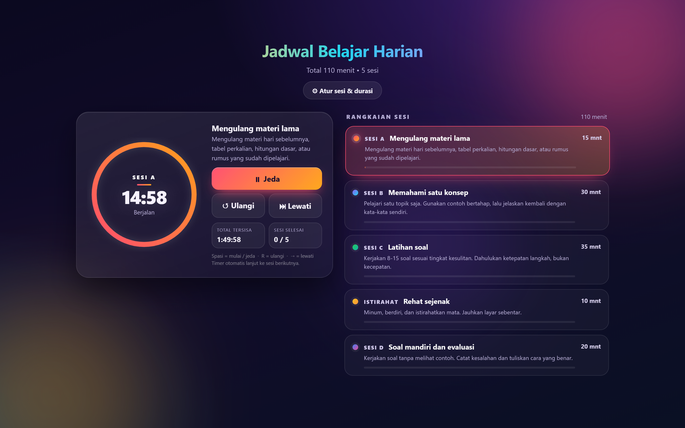
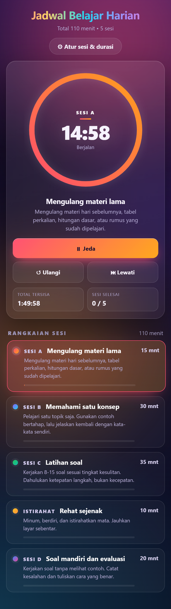
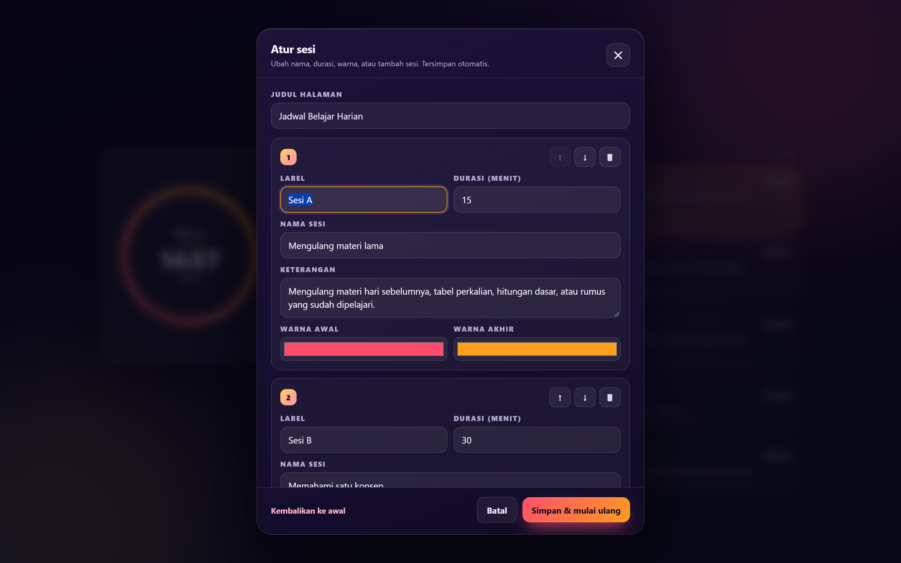

# ⏳ Timer Belajar Seru

**Belajar fokus, istirahat tepat, progres kelihatan. 🚀**

Timer warna-warni untuk pelajar SMA dan mahasiswa yang ingin belajar terjadwal tanpa harus membuka banyak aplikasi. Semuanya berjalan di browser, jadi kamu tidak perlu instal apa pun, tidak perlu membuat akun, dan bisa langsung mulai dalam hitungan detik. 🎨

👉 **Coba sekarang:** https://fathahnoor.github.io/timer-belajar/

## 📸 Tampilan



<p align="center">
  
</p>



## 😵 Masalah yang bikin timer ini ada

Belajar dua jam sekaligus sering berakhir begitu: dua puluh menit serius, seratus menit rebahan sambil buka HP. 📱

Timer ini membagi waktu menjadi beberapa sesi pendek yang jelas, mulai dari mengulang materi lama, memahami satu konsep, latihan soal, istirahat, sampai evaluasi di akhir. Setiap sesi punya warna sendiri, sehingga kamu bisa tahu posisi sekarang hanya dengan melihat cincin timer. 🧠

## ✨ Yang bikin seru

Cincin timer, kartu, dan latar berganti warna setiap kali sesi berganti, jadi belajar terasa seperti memainkan game kecil. 🌈

Saat waktu sesi habis, bel berbunyi terus sampai kamu menekan **Matikan bel**, lengkap dengan getaran di HP. Timer berhenti di sesi itu dan tidak pindah sendiri. Setelah bel mati, tekan **Sesi berikutnya** kalau sudah siap lanjut. 🔔

Semua pengaturan ada di dalam halaman. Kamu bisa mengganti nama sesi, mengubah durasi, memilih warna, menggeser urutan, menambah sesi baru, atau menghapus sesi yang tidak dipakai tanpa menyentuh kode sama sekali. ⚙️

Pengaturan itu tersimpan otomatis di browser, jadi tetap ada setelah halaman di-refresh atau ditutup. Tampilannya juga menyesuaikan layar HP vertikal, tablet, dan laptop landscape. 💾📱

Tombol **Layar penuh** membuat cincin dan angka waktu memenuhi layar, sementara tombol lain mengecil jadi dua kontrol kecil di bawah. Tekan **Esc** atau **Keluar** untuk kembali. 🖥️

## 🚀 Cara pakai

1. Buka tautan demo di HP atau laptop, lalu tekan **Mulai**. Timer akan langsung menghitung mundur dari sesi pertama. ▶️
2. Ikuti jadwalnya, dan pakai tombol **Jeda**, **Ulangi**, atau **Lewati** kalau kamu perlu berhenti sebentar atau berpindah sesi. ⏸️
3. Saat sesi terakhir habis, bel berbunyi sampai dimatikan. Setelah itu kamu bisa memulai jadwal baru dari awal. 🎉

## 📚 Jadwal bawaan

| Sesi | Kegiatan | Durasi |
|---|---|---|
| 🅰️ Sesi A | Mengulang materi lama | 15 menit |
| 🅱️ Sesi B | Memahami satu konsep | 30 menit |
| 🅲 Sesi C | Latihan soal | 35 menit |
| ☕ Istirahat | Minum, berdiri, istirahatkan mata | 10 menit |
| 🅳 Sesi D | Soal mandiri dan evaluasi | 20 menit |

Totalnya 110 menit. Mau pas 120 menit? Buka panel pengaturan, ubah salah satu durasi, lalu simpan. Selesai. ✅

## ⚙️ Ubah jadwal sesukamu

Klik tombol **⚙ Atur sesi & durasi** di bagian atas halaman.

- Ganti **label**, **nama**, dan **keterangan** sesi supaya cocok dengan cara belajarmu, misalnya menamai sesi sesuai mata pelajaran hari itu. ✏️
- Ubah **durasi** dalam menit, dan kamu boleh memakai angka desimal seperti `0.5` kalau ingin mencoba sesi singkat selama 30 detik. ⏱️
- Pilih dua **warna** untuk tiap sesi, lalu lihat perubahannya langsung di cincin timer dan kartu sesi. 🎨
- Geser urutan dengan tombol **↑** dan **↓** kalau ada sesi yang ingin dipindah ke awal atau ke akhir. ↔️
- Tambah sesi baru lewat **＋ Tambah sesi**, atau hapus sesi yang tidak perlu ketika jadwalmu berubah. 🗑️
- Tekan **Simpan & mulai ulang** untuk menerapkan semua perubahan, dan timer akan kembali ke sesi pertama.
- Salah eksperimen? Klik **Kembalikan ke awal** untuk memulihkan jadwal bawaan tanpa harus mengubah file. ↩️

Jumlah sesi bebas. Mau 3 sesi, 6 sesi, atau 10 sesi, semuanya bisa. Timer akan mengulang dari sesi pertama setelah kamu menekan Simpan, jadi simpan di waktu yang tepat. 😎

## ⌨️ Shortcut keyboard

| Tombol | Fungsi |
|---|---|
| `Spasi` | Mulai atau jeda |
| `R` | Ulangi dari awal |
| `→` | Lewati ke sesi berikutnya |
| `F` | Masuk atau keluar layar penuh |
| `Esc` | Tutup panel pengaturan atau keluar layar penuh |

Shortcut ini aktif di laptop. Kalau kamu membuka timer di HP, cukup sentuh tombolnya. 👆

## 🎯 Cocok buat siapa

Timer ini pas untuk pelajar SMA yang sedang menyiapkan ulangan atau UTBK, mahasiswa yang ingin belajar lebih terukur tanpa aplikasi tambahan, dan siapa pun yang gampang terdistraksi oleh notifikasi. 📖🎓

Guru atau tutor juga bisa memakainya sebagai contoh timer di kelas, asalkan durasi dan nama sesinya disesuaikan dengan materi yang sedang dibahas. 🧑‍🏫

Timer ini tidak menggantikan jadwal sekolah atau kampusmu, jadi anggap saja sebagai alat bantu kecil untuk menjaga ritme belajar di rumah. 🌱

## 🛠️ Jalankan di komputer

Timer ini cuma memakai HTML, CSS, dan JavaScript biasa. Tidak ada proses build dan tidak ada dependency yang perlu dipasang.

```bash
git clone https://github.com/fathahnoor/timer-belajar.git
cd timer-belajar
```

Buka `timer-belajar.html` di browser, lalu tekan Mulai. Selesai. 🎈

Kalau mau mengubah nilai bawaan secara permanen, buka blok `CONFIG` di dalam file. Untuk pemakaian sehari-hari, panel pengaturan sudah cukup. 😉

## 🗂️ Isi repo

```
timer-belajar/
├── index.html           # pengalih ke timer
├── timer-belajar.html   # aplikasi timer
├── screenshots/         # gambar tampilan untuk README
└── README.md
```

## 🤝 Ide dan kontribusi

Punya ide fitur, menemukan bug, atau ingin membuat versi untuk kelasmu? Buka issue atau kirim pull request di repo ini. 🙌

Kalau timer ini membantu, kasih ⭐ supaya teman lain lebih mudah menemukannya. ⭐

---

Dibuat untuk belajar yang lebih tenang dan teratur, terutama ketika tenggat tugas sudah mendekat dan fokus mulai buyar. Kalau kamu punya cerita atau masukan, tulis saja di issue. Selamat mencoba! 🌱
